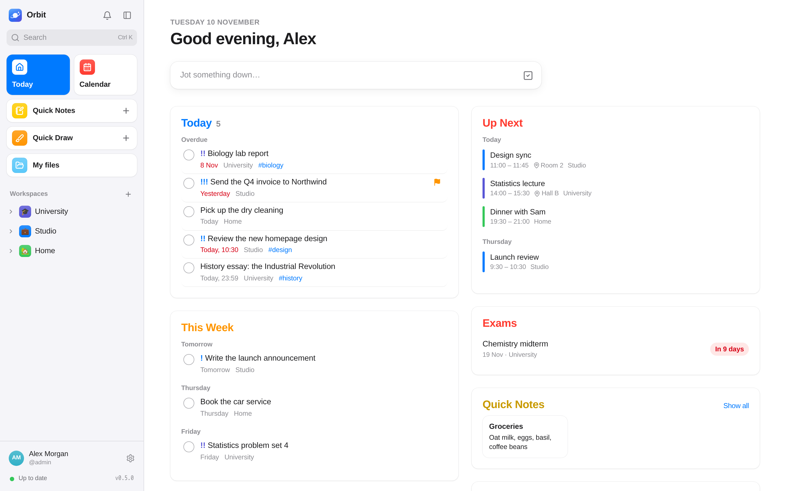

# Orbit

A self-hosted planner for every part of your life. Make a **workspace** for
school, work, home, a shared household — each with only the **modules** it
needs — and keep everything in one place that looks and feels like an Apple
app.

<picture>
  <source media="(prefers-color-scheme: dark)" srcset="docs/images/today-dark.png">
  
</picture>

- **Today** — what's late, due and coming up across every workspace, with
  each shared workspace's activity ("Ana completed 3 tasks").
- **Pages** — documents in Markdown, edited visually or as source (with VS
  Code's keys: several cursors, moving lines, find and replace): headings,
  checklists, tables, callouts, code, images; pages inside pages,
  favourites, a trash, templates, @-mentions and backlinks, databases
  (tables and boards of pages with properties); export as
  Markdown or PDF, import Markdown, Notion and Apple Notes. Sums work in
  them (`120 + 35 =`).
- **Tasks** — Reminders-style lists with due dates and times, repeats,
  priorities, tags, sub-tasks, several people, notes in Markdown, files,
  comments with @mentions, smart lists (and your own, saved from a filter).
  Quick add understands "Essay tomorrow 14:30 !! #maths" and "Bins every
  other Tuesday".
- **Boards, Timeline, Charts** — the same tasks as kanban columns, as bars on
  a Gantt chart (with dependencies: move one and what waits on it moves
  too), and as charts (a workload view; each downloads as PNG or CSV).
- **Calendar** — month, week and day (drag to move and resize); events with
  repeats, reminders and their own time zone; public holidays; tasks on
  their dates; subscribed calendars; a private feed for Apple, Google or
  Outlook; and **two-way sync** with iCloud, Nextcloud or any CalDAV server.
- **Notes** — sticky notes and checklists, with colours, pins, sums,
  reminders, files and a drawing; your own **Quick Notes** and **Quick Draw**
  sketches from anywhere, and things shared from your phone land there.
- **Whiteboards** — hand-drawn sketches and diagrams (Excalidraw).
- **Sheets** — spreadsheets with Excel's formulas (English or Portuguese
  names), ranges, other tabs, lookups, fill handle, copy-paste with Excel,
  rows and columns that move the references; `.xlsx` and `.csv` in and out;
  shown in a page by its link.
- **School** — courses with their weekly timetable on the calendar, exams
  with a countdown, grades with weighted averages and what you need to pass.
- **Habits, Focus timer, Goals, Journal, Bookmarks** — streaks and a year
  grid; Pomodoro sessions logged on tasks; goals with progress from their
  tasks; a private page a day with a mood and "on this day"; links with a
  preview, tags and read later.
- **Git** — lists that are a GitHub, GitLab, Gitea or Forgejo repository's issues,
  kept in step both ways (comments, labels, milestones, webhooks for
  instant updates); each person acts with their own account.
- **Search** — full text across everything you can see (⌘K).
- **Notifications** — a bell, push to your devices, and email, ntfy,
  Telegram, Discord, Slack, Teams or Gotify; a daily summary; snooze; quiet
  hours.
- **Shared workspaces** — invite people (or send an invite link) as owner,
  editor or viewer; changes appear live for everyone. A workspace is
  private to its members: instance admins manage accounts, not your
  planner. Move a whole workspace to another Orbit (export / import).
- **Accounts** — passwords with two-factor (authenticator app or passkey),
  passkeys, SSO (OpenID Connect), sign in with Gitea, GitHub or GitLab for the git
  integration, API tokens (optionally read-only), a tamper-evident audit
  log, encrypted backups.
- **Anywhere** — light and dark, developer themes, English and Portuguese,
  and installable on a phone (Add to Home Screen) with a bottom tab bar and
  the share sheet.

Each workspace turns on only the **modules** it needs (Workspace settings →
Modules).

## What's where

| Path | What |
|---|---|
| [api/](api/) | The backend (Go, Gin, GORM + SQLite or PostgreSQL); API reference at `/api/docs`, see [docs/API.md](docs/API.md) |
| [web/](web/) | The app (Vue 3, Vite, Tailwind, TipTap) |
| [docs/](docs/) | Guides and blueprints (see [Documentation](#documentation)) |
| [deploy/](deploy/) | Monitoring: Prometheus + Grafana, a dashboard and alert rules |

## Quick start

```sh
cp .env.example .env        # set JWT_SECRET and ORBIT_MASTER_KEY (openssl rand -hex 32 each)
docker compose up -d        # on http://localhost:8080
```

> **Back up `ORBIT_MASTER_KEY`.** It seals two-factor secrets, the SSO client
> secret and subscribed calendar addresses. Lose it and those can't be read.

**First sign-in.** On an empty database Orbit creates the admin account
`ADMIN_USER` (default `admin`), who is also the instance **owner**:

- with `ADMIN_PASSWORD` set, sign in with it;
- without it, a temporary password is printed once in the log:

  ```sh
  docker compose logs api | grep "First sign-in"
  ```

Either way you choose your own password at the first sign-in. Then **New
workspace** (the `+` next to Workspaces), pick a template, choose its modules.

**More people.** Admin → Users → New user. New accounts get the `member` role
(they can create workspaces); `none` accounts only see workspaces they're
invited to. Invite someone to a workspace from its settings (`⋯` → Members).

## Deployment

One container and one volume (`/data`). Put it behind your reverse proxy with
TLS (or set `TLS_CERT_FILE` / `TLS_KEY_FILE`), and set:

- `PUBLIC_URL` — the address people use, for calendar-feed links;
- `WEBAUTHN_RP_ID` / `WEBAUTHN_RP_ORIGINS` — the host name, for passkeys;
- `TRUSTED_PROXIES` — your reverse proxy, so rate limits and the audit log
  see real client addresses.

`docker-compose-build.yml` builds from source instead of pulling. Backups:
Owner → Owner → Backups (download now, or automatic to a directory or S3). Every
variable: [docs/CONFIGURATION.md](docs/CONFIGURATION.md).

## Development

Nothing but Docker on the host.

```sh
make dev                    # API with live reload + the app with Vite → http://localhost:5180 (admin / admin)
make test vet lint          # Go tests, vet, golangci-lint
make web-test web-typecheck web-lint
make swag                   # regenerate the OpenAPI spec after changing handlers
```

| Target | Does |
|---|---|
| `make dev` | the dev stack (`docker-compose.dev.yml`): API on :8090, app on :5180 |
| `make test` / `vet` / `lint` / `vuln` | Go checks, in a pinned container |
| `make web-test` / `web-typecheck` / `web-lint` / `web-build` | the web checks |
| `make check` | what CI's Test workflow runs (minus lint) |
| `make image` / `up-build` | build the image locally / build and run it |
| `make set-version VERSION=x.y.z` | bump every version marker |

## Security

Workspace content is visible only to its members — the API answers 404 to
anyone else, admins included. Secrets at rest are sealed with AES-256-GCM
under `ORBIT_MASTER_KEY`; calendar addresses are fetched through an
SSRF-guarded client. Details: [docs/SECURITY.md](docs/SECURITY.md).

## Documentation

| Doc | For |
|---|---|
| [USER-GUIDE.md](docs/USER-GUIDE.md) | Using Orbit: every module, notifications, sharing, settings |
| [CONFIGURATION.md](docs/CONFIGURATION.md) | Every environment variable |
| [SECURITY.md](docs/SECURITY.md) | Threat model, what's protected and how |
| [API.md](docs/API.md) | Scripting Orbit with API tokens |
| [SSO-entra.md](docs/SSO-entra.md), [SSO-authentik.md](docs/SSO-authentik.md) | Single sign-on |
| [TROUBLESHOOTING.md](docs/TROUBLESHOOTING.md) | Symptoms and fixes |
| [ARCHITECTURE.md](docs/ARCHITECTURE.md) | How it's built and why |
| [RELEASING.md](docs/RELEASING.md) | Cutting a release |
| [ROADMAP.md](docs/ROADMAP.md) | What could come next |
| [BLUEPRINT-FIT.md](docs/BLUEPRINT-FIT.md) | How the project blueprint applies here |
| [PROJECT-BLUEPRINT.md](docs/PROJECT-BLUEPRINT.md), [AUTH-BLUEPRINT.md](docs/AUTH-BLUEPRINT.md) | The blueprints Orbit follows |

## License

Apache-2.0 — see [LICENSE](LICENSE).
